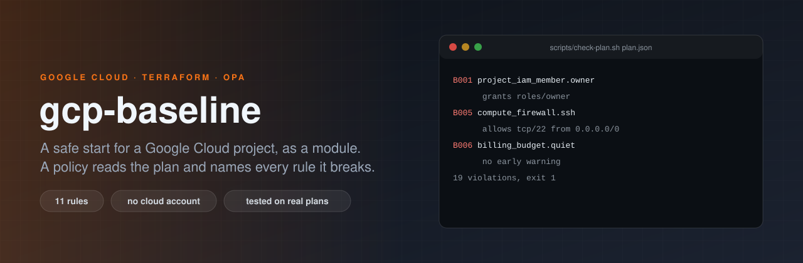

<p align="center"></p>

# gcp-baseline

[](https://github.com/ErenOzgu/gcp-baseline/actions/workflows/ci.yml)


**A safe start for a Google Cloud project, and a check that keeps it that way.** Two parts that fit together:

- a Terraform module (`modules/baseline`) that gives a new project a budget with alerts, an audit log bucket nobody
  can quietly empty, organization policies that close the usual doors, and service accounts and group roles without
  Owner or Editor;
- an Open Policy Agent policy (`policy/baseline.rego`) that reads any Terraform plan for Google Cloud, not only this
  module's, and lists every resource that breaks one of eleven rules, with the rule's number and what is wrong.

Both are tested without a Google Cloud account. It is a small, opinionated baseline, not a landing zone and not a
compliance benchmark: see [What it cannot do](#what-it-cannot-do).

## Why

The first hour of a Google Cloud project decides a lot. Someone grants Owner "just for now", a firewall rule opens SSH
to the world to debug something, a service account key is downloaded and forgotten, nobody notices the bill until the
invoice, and the logs that would explain it all were never kept. Every one of these is easy to prevent and hard to
notice afterwards. This repository does the prevention in the module and the noticing in the policy, which also works
on infrastructure the module never created.

## Try it, with no cloud account

```sh
git clone https://github.com/ErenOzgu/gcp-baseline && cd gcp-baseline
sudo scripts/install-opa.sh                  # OPA 1.4.2, checked against a pinned SHA-256 (Linux x86-64)
opa test policy --verbose | tail -3          # the policy's own tests

scripts/plan-example.sh examples/violating plan.json    # needs terraform; plans with a made-up access token
scripts/check-plan.sh plan.json              # one line per violation, exit status 1
```

`plan` only works out what the configuration would create, so a made-up token is enough: nothing is created and
nothing in Google Cloud is contacted for credentials. `examples/violating` is a configuration with at least one
resource for each rule; this is the exact report it gets, checked on every push:

<!-- include:examples/violating/expected.txt -->
```text
B001 google_project_iam_member.owner: grants roles/owner; use the narrowest predefined or custom role
B002 google_storage_bucket_iam_member.public: grants a role to allUsers, which is anyone on the internet
B003 google_service_account_key.legacy: creates a service account key; use workload identity federation or an attached service account
B004 google_storage_bucket.open: public_access_prevention is not "enforced"
B004 google_storage_bucket.open: uniform_bucket_level_access is not true
B005 google_compute_firewall.all_tcp: allows all tcp ports from 0.0.0.0/0
B005 google_compute_firewall.rdp_range: allows tcp/3380-3400 (includes 3389) from 0.0.0.0/0
B005 google_compute_firewall.ssh: allows tcp/22 from 0.0.0.0/0
B006 google_billing_budget.quiet: has no threshold at or above 100 %
B006 google_billing_budget.quiet: has no threshold at or below 50 %, so there is no early warning
B006 google_billing_budget.quiet: names no notification target (a Pub/Sub topic or notification channels) in all_updates_rule
B007 google_logging_project_exclusion.audit: excludes audit logs from the log router
B007 google_logging_project_sink.shared: unique_writer_identity is not true: the sink shares a writer identity with every other sink of the project
B008 google_org_policy_policy.keys: relaxes iam.disableServiceAccountKeyCreation
B008 google_project_organization_policy.public_access: relaxes storage.publicAccessPrevention
B009 google_compute_instance.bastion: has an external IP address (access_config); reach it through IAP or Cloud NAT instead
B009 google_compute_instance.bastion: switches OS Login off (metadata enable-oslogin)
B010 google_project_iam_policy.authoritative: is an authoritative IAM policy: it replaces every binding on the resource and can lock everyone out; use the _member resources
B011 google_sql_database_instance.open: authorizes 0.0.0.0/0 to connect
```

`examples/good` is the module itself with dummy values. Its plan creates 31 resources and the policy finds nothing.

## The module

<!-- include:examples/good/main.tf -->
```hcl
# A project baseline with dummy values. `terraform plan` needs no credentials worth having:
# CI plans it with a made-up access token, because creating these resources is never attempted.
terraform {
  required_version = ">= 1.5"

  required_providers {
    google = {
      source  = "hashicorp/google"
      version = "6.8.0"
    }
  }
}

provider "google" {
  project = "demo-baseline-1234"
  region  = "europe-west3"
}

module "baseline" {
  source = "../../modules/baseline"

  project_id         = "demo-baseline-1234"
  project_number     = "123456789012"
  billing_account_id = "01ABCD-234567-89EFGH"

  budget_amount       = 200
  budget_currency     = "EUR"
  budget_alert_emails = ["finops@example.com"]

  audit_bucket_name    = "demo-baseline-1234-audit-logs"
  audit_retention_days = 365

  service_accounts = {
    "ci-deployer" = {
      display_name = "CI deployer"
      roles        = ["roles/storage.objectAdmin", "roles/run.developer"]
    }
    "app-runtime" = {
      display_name = "Application runtime"
      roles        = ["roles/logging.logWriter", "roles/monitoring.metricWriter"]
    }
  }

  group_roles = {
    "roles/viewer"                 = ["engineering@example.com"]
    "roles/logging.viewer"         = ["engineering@example.com", "support@example.com"]
    "roles/billing.projectManager" = ["finops@example.com"]
  }

  labels = {
    managed-by = "terraform"
    baseline   = "gcp-baseline"
  }
}

output "enforced_constraints" {
  value = module.baseline.enforced_constraints
}
```

What that creates:

| Part | Resources | Why |
| --- | --- | --- |
| APIs | `google_project_service` for billing budgets, IAM, logging, monitoring, org policy, Pub/Sub and storage | The rest needs them. They are not disabled again on destroy. |
| Budget | `google_billing_budget`, a Pub/Sub topic `budget-alerts`, one e-mail notification channel per address | Alerts at 50, 80 and 100 % of current spend and at 100 % of the forecast, so the first warning comes early. |
| Audit logs | A bucket with uniform access, public access prevention, versioning and a retention period; a log sink with its own writer identity; the permission the sink needs | Audit logs are copied to a bucket where objects cannot be deleted or replaced during the retention period. The lock option makes that final. |
| Organization policies | Seven boolean constraints enforced, and external IP addresses on VMs denied | Closes service account keys, public buckets and database IPs, serial ports and SSH keys outside OS Login before anyone opens them. |
| Identities | Service accounts with the roles you list, and project roles for groups | Owner and Editor are refused by the module itself. |

The inputs. Every one has a validation, so a typo fails at `plan` with a sentence that says what is wrong:

| Input | Default | Meaning |
| --- | --- | --- |
| `project_id` | required | Project ID, 6 to 30 characters. |
| `project_number` | required | The project's number. The budget filter needs it, not the ID. |
| `billing_account_id` | required | `XXXXXX-XXXXXX-XXXXXX`. |
| `budget_amount` | required | Monthly budget, a positive whole number. |
| `budget_currency` | `"EUR"` | Must be the currency of the billing account. |
| `budget_thresholds` | `[0.5, 0.8, 1.0]` | Fractions of the budget that alert on current spend. Needs one at or below 0.5 and one at or above 1.0. A forecast alert at 100 % is always added. |
| `budget_alert_emails` | `[]` | Addresses that get a Cloud Monitoring e-mail. Alerts also go to the Pub/Sub topic. |
| `audit_bucket_name` | required | Globally unique bucket name. |
| `audit_bucket_location` | `"EU"` | Bucket location. |
| `audit_retention_days` | `365` | Retention period, at least 30. |
| `lock_audit_retention` | `false` | Lock the retention policy. **A locked policy can never be shortened or removed**, and the bucket can then only go away with the project. |
| `enforced_boolean_constraints` | seven constraints | Organization policy constraints to enforce: service account key creation and upload, uniform bucket access, public access prevention, OS Login, serial port access, public Cloud SQL IPs. |
| `deny_external_ips` | `true` | Deny external IPs on VMs (`compute.vmExternalIpAccess`). |
| `service_accounts` | `{}` | Account id to `{display_name, roles}`. No Owner or Editor, no empty or duplicate roles. |
| `group_roles` | `{}` | Role to group e-mail addresses. No Owner or Editor. |
| `enable_apis` | `true` | Enable the APIs the module needs. |
| `labels` | `{}` | Labels for the resources that take them. |

Outputs: `audit_bucket`, `audit_sink_writer_identity`, `budget_name`, `budget_topic`, `service_account_emails` and
`enforced_constraints`. The provider is constrained to `>= 6.8, < 7.0`; everything here is tested with 6.8.0.

## The policy

`policy/baseline.rego` takes the JSON of a plan (`terraform show -json PLAN`) and produces one line per violation.
It looks at every resource the plan creates, updates or replaces, in any module, and ignores resources that are only
being deleted.

<!-- rules:start -->
| Rule | What it requires |
| --- | --- |
| B001 | No Owner or Editor role on a project, folder or organization |
| B002 | No IAM binding to allUsers or allAuthenticatedUsers |
| B003 | No service account keys |
| B004 | Storage buckets use uniform bucket-level access and enforce public access prevention |
| B005 | No firewall rule opens SSH, RDP, all ports or all protocols to the internet |
| B006 | A budget warns early (50 % or lower), warns at 100 % or more, and names a notification target |
| B007 | Log sinks have their own writer identity and nothing excludes audit logs |
| B008 | No organization policy relaxes a protected constraint |
| B009 | Compute instances have no external IP and do not switch OS Login off |
| B010 | No authoritative IAM policy resource |
| B011 | Cloud SQL does not authorize 0.0.0.0/0 |
<!-- rules:end -->

```sh
terraform plan -out=plan.bin && terraform show -json plan.bin > plan.json
scripts/check-plan.sh plan.json                    # lists violations; exit 0 none, 1 violations, 2 not a plan
scripts/check-plan.sh plan.json --expect FILE      # succeed only when the report is exactly FILE
```

Rules judge the value in the plan, so provider defaults count: with the google provider 6 a log sink that does not
mention `unique_writer_identity` already plans `true` and passes B007, while with older providers the default was
`false` and the same configuration would fail.

From OPA directly, `data.baseline.deny` is a set of `{rule, resource, message}` objects and `data.baseline.report` is
the sorted text. A file that is not a plan (an empty file, a state file, a typo in the path) is refused with exit
status 2 instead of being reported as "no violations".

To run it on every pull request, this workflow plans and then judges the plan:

<!-- include:examples/ci/plan-policy.yml -->
```yaml
# A pull request check for a repository that holds Terraform for Google Cloud: plan, then judge the plan.
name: Plan policy

on:
  pull_request:

permissions:
  contents: read
  id-token: write

jobs:
  plan-policy:
    runs-on: ubuntu-latest
    steps:
      - uses: actions/checkout@v4
      - uses: actions/checkout@v4
        with:
          repository: ErenOzgu/gcp-baseline
          ref: main # pin this to a commit once you rely on it
          path: gcp-baseline
      - uses: hashicorp/setup-terraform@v3
        with:
          terraform_wrapper: false
      # Authenticate to Google Cloud here, for example with google-github-actions/auth and workload identity
      # federation. A real plan needs read access to the project.
      - name: Plan
        run: |
          set -euo pipefail
          terraform init -input=false
          terraform plan -input=false -lock=false -out="$RUNNER_TEMP/plan.bin"
          terraform show -json "$RUNNER_TEMP/plan.bin" > "$RUNNER_TEMP/plan.json"
      - name: Judge the plan
        run: |
          sudo gcp-baseline/scripts/install-opa.sh
          gcp-baseline/scripts/check-plan.sh "$RUNNER_TEMP/plan.json"
      # plan.json can contain secrets. Do not upload it as an artifact.
```

## How it is tested

- **The policy has 51 unit tests and every line of it is executed** (`opa test policy --coverage --threshold 100`).
  Each rule has a case that fires, cases that must not fire, the unknown-value cases and the message text.
- **The module has `terraform test` runs** (`modules/baseline/tests`) with the google provider mocked: the defaults,
  the switches, the identities, and 24 bad inputs that every validation must refuse.
- **Real plans.** CI plans `examples/good` and `examples/violating` with the real google provider 6.8.0 and checks
  that the first has no violations and creates exactly the 31 resources stated above, and that the second produces exactly the report
  above. If the provider ever shapes a plan differently from what the rules expect, that comparison fails.
- **The policy catches a weakened module.** CI copies the module, switches off uniform bucket access, public access
  prevention, the sink's own writer identity and the seven enforced constraints, plans the copy, and expects exactly
  the ten violations written down in `tests/weakened-module.expected.txt`.
- The README is checked against the code: the rules table is generated from the policy, the example blocks are the
  committed files, and every module input is described (`scripts/check-readme.sh`).
- Lint: `terraform fmt`, `opa fmt`, `opa check --strict`, shellcheck, actionlint, and a secrets scan before every push.

## What it cannot do

- **The policy only sees the plan.** What is already in the project, changes made outside Terraform and resources
  created by other tools are not judged. It is a gate in front of changes, not an audit of what exists.
- **A value the plan does not know yet passes.** If a role, member or setting is the result of something created in
  the same plan, the rule cannot judge it and does not guess. The module's own references are of that kind (the
  budget's topic, the sink's writer identity) and are accepted for that reason.
- **It is not the CIS benchmark** and does not claim any compliance. Eleven rules were picked because they are the
  ones that most often hurt a young project, not because they are complete.
- **There is no exception mechanism.** A rule that does not fit a resource has to be changed in the policy, for
  everyone. Rules judge resource types the google provider has; other providers' resources are not looked at.
- **The module has never been applied to a real project.** It was written and tested in a sandbox with no Google
  Cloud account. It is planned with the real provider on every push and covered by `terraform test`, but the first
  `apply` may still meet an API detail no plan can show. Read the plan, and start in a project you can delete.
- **Budget alerts to the Pub/Sub topic are not proven to arrive.** The module creates the topic and does not grant
  any permission to publish to it. Whether Cloud Billing needs one is something to check after applying, by
  spending over a threshold in a test project or by reading the topic's metrics. The e-mail notification channels do
  not depend on this.
- **Organization policies are an organization feature.** The module sets them on the project, which needs the
  Organization Policy API and a role that may set policies (usually Organization Policy Administrator). What happens
  in a project that is not inside an organization has not been checked.
- **Data Access audit logs are not switched on.** Admin Activity logs are always on and are what the sink exports;
  Data Access logs are off by default in Google Cloud, cost money, and need `google_project_iam_audit_config`. The
  module leaves that decision to you.
- **Retention locking cannot be undone.** `lock_audit_retention = true` makes the retention period permanent for the
  life of the bucket. It is off by default for that reason.
- **No network, no folders, no organization-level setup.** Nothing here creates a VPC, a landing zone or an
  organization hierarchy.
- **Plan files can contain secrets.** `terraform show -json` prints values in the clear. The scripts here write the
  plan where you tell them and never upload it.

## Layout

```
modules/baseline/        the module, and its terraform tests in tests/
policy/                  baseline.rego and its unit tests
examples/good/           the module with dummy values
examples/violating/      one violation per rule, and the exact report in expected.txt
examples/ci/             a pull request workflow for your own repository
scripts/                 check-plan.sh, plan-example.sh, install-opa.sh, rules-table.sh, check-readme.sh
tests/                   the report expected from a weakened module
```

## License

MIT, see [LICENSE](LICENSE).
